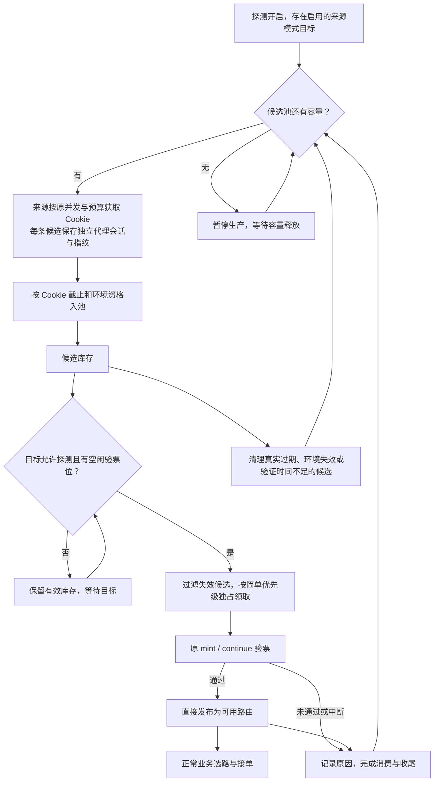

# 候选库存与目标验票解耦实施计划

日期：2026-10-13。状态：实现、自动化回归和本地新版本 20 分钟真实验收已完成。完成记录见 `borrow-candidate-pool-implementation-20261013.md`。

本计划落实用户确认的四点：来源补库存；按 Cookie 与实际环境保留候选；目标领取后按原标准验票、成功直接发布；同步修复续租和异常收尾。实施范围以本文件为准，收敛此前 `borrow-candidate-gateway-optimization-plan-20261013.md` 中的探索性方案。

## 一、证据与预期

最近真实验证见 [可行性报告](borrow-pool-feasibility-validation-20261013.md)。82 条候选入池，66 次完整目标判定中 13 次通过并发布；另 2 次环境中断单列。3 条候选在收到 Cookie 后 128—171 秒开始验票仍通过，随后承载 7 次业务，5 次正确、2 次上游过载失败。候选超过旧 110 秒仍有实际价值。

基线与历史筛选分别 6/33、7/33，尚未证明排序提高命中率。池有库存时后段仍连续 17 次完整判定无成功，约 11 分 15 秒时因目标续租异常结束；因此本次改造的确定目标是消除过早淘汰、供需耦合与异常停供，命中率和连续业务质量须另行实测。

上游声明约一小时只作为候选保留的期限证据，不等于一小时持续兼容，也不等于业务路由可以接单一小时。

## 二、最终流程

目标只负责自己的并发、预算、冷却、领取和验票。来源只负责库存供给，不依赖某个目标任务的短期租约或即时空闲槽位。已有路由后的目标探测节奏继续由现有滚动补充/库存规则决定；候选库存充足本身不强制目标持续发请求。

## 三、具体改动

### 1. 来源按容量补库存

- 本版使用现有池容量作为备货上限和满池暂停条件，默认 64；不增加第二个备货数量或水位配置。这是简化后的实施选择，不代表已经证明 64 最优。
- 容量统一计入获取中、待领取、已领取验票中。预留和领取使用数据库事务计数，多个生产者不能超卖容量。已领取候选验票收尾后释放容量，再补入新候选。
- 来源并发、来源请求预算、账号健康和冷却继续生效；填库存不绕开限流。目标有一条合格候选即可领取，不等待池满或多个网关到齐。
- 生产资格改为“全局探测开启且存在启用的来源模式目标”，与目标此刻是否拥有空闲槽位、处于预算等待、已有可用路由或正在交接任务脱钩。供给速度仍受来源自己的限制。
- 删除只预取 2 条以及按瞬时目标需求限制库存的旧限制。目标需求记录如仍用于领取公平性，仅用于消费调度，不再决定候选寿命和生产资格。
- 目标暂时忙、短期预算等待、冷却或任务重建时保留库存；已经发出的来源获取不因目标需求短暂消失而丢弃结果。
- 无任何启用的来源模式目标时暂停生产，尚有效且未被明确撤销的库存等待后续消费或自然清理。用户明确停止全局探测、清空池或撤销相关配置时按停止语义收尾，并标记具体原因；业务在途请求继续自然结束。
- 下调容量时先停止补货；必要时释放多余未领取库存，优先清理不合格候选，不抢占正在获取/验票/业务使用的环境。活动工作导致短暂高于新上限时等待排空，页面如实显示。

### 2. 拆清候选、验票与接单的时间

| 时间 | 本版定义 | 不再承担的职责 |
| --- | --- | --- |
| 候选保留截止 | Cookie 首次观测确定的声明截止，并受已知关联凭证截止约束；环境撤销另行判失效 | 不使用固定 15 秒排队寿命或来源开始后 110 秒窗口 |
| 单次验票截止 | 领取后使用原有 mint、continue、发布预留与总验证边界，并受候选截止限制 | 不把一小时 Cookie 声明变成一小时 HTTP 请求 |
| 路由接单截止 | 首次成功发布时刻 + 现有接单窗口，并取 Cookie/相关凭证截止的较早值 | 不再从来源获取开始计时，不延长已发请求的执行时限 |
| 工作所有权租约 | 运行期间续租，负责互斥和崩溃恢复 | 不代表候选保留期或固定批次寿命 |

实施规则：

1. 删除 `BorrowCandidatePoolQueueLifetime` 的固定 15 秒终结逻辑；移除来源开始时间加接单窗口对候选环境、领取、验票和发布的联动限制。
2. 没有可解析 Cookie 声明时标为“有效期未知”，使用首次观测时确定的保守回退截止，不推定一小时，不因重新读取或重试刷新。同一 Cookie 后续明确更早的截止只能收紧；删除 Cookie 按失效处理。
3. 候选保存自己的 Cookie、来源凭证标识、代理会话与指纹。来源为后续候选轮换环境，不应仅因当前绑定版本变化就作废旧候选已经冻结且仍合法的独立环境；原代理条目撤销、必要凭证失效等真实变化仍立即影响未发送工作的资格。
4. queued 库存通过候选记录持有冻结环境，不占来源/目标 HTTP 执行槽，也不能被来源获取任务结束或旧环境执行租约到期误回收。领取后转为验票持有，发布成功后衔接路由持有，最后一个合法持有者结束才释放环境。
5. 领取前按现有阶段预算检查剩余时间；不够完成验证的候选以“验证时间不足”收尾，不能记成已经观测到上游 Cookie 过期。每次实际出站前仍做时间和资格检查。
6. **业务接单窗口改以首次成功发布为起点**，保持原配置长度。这是本次必要的语义调整：否则几分钟前的候选即使验票通过，仍无法正常发布接单。发布重试、重复观察不得刷新首次发布时间或截止。
7. 修复 `SaveSettings`：切换运行状态或修改无关配置不能按“来源开始 + 窗口”批量重算历史截止。真正缩短窗口时，仅按各路由正确的原始锚点收紧；增加窗口只作用于之后新发布的路由。候选 Cookie 截止不受业务窗口编辑影响。
8. 自身模式复用相同的有效期计算和发布规则，仍保持目标身份隔离；不把目标自身获取的 Cookie 自动放进跨目标共享池。

代理配置和指纹哈希只能证明配置是否变化，不能证明真实出口 IP 恒定。环境是否仍兼容目标，最终仍由现有验票判断。

### 3. 目标按简单规则领取，通过即发布

第一版只用两级优先级：**普通候选优先，近期确定不兼容的网关候选短暂靠后**。同级选择最早入池且仍满足验证预算的候选，避免老库存长期被新入池候选压住；只有降级候选时仍允许尝试，不停在那里等新候选。

- 沿用已有近期反馈：同一目标及身份范围内，120 秒内 3 次明确票据/Cookie 不一致触发 30 秒降级；成功解除，降级到期恢复。时间边界使用现有常量，不新增用户配置。
- 503、连接失败、流错误、超时和正常取消分开统计，不累计为确定票据不兼容，不传播为其他目标的失败。
- 本版不增加近期成功专用加权、网关评分、永久名单或“曾成功就排斥”。先验证候选资格与基本选择行为是否正确。
- 相同 Cookie 按现有范围去重；同一网关的新 Cookie 可正常入池。一次领取独占，一次正常消费后留证结束，不将失败候选无限回池重试。
- 多目标沿用公平领取和原总并发；目标准入、验票后的发布守卫及路由库存判断使用一致规则。已获准执行的验证不能仅因并行任务先发布，就把本次完整通过误记为上游失败。
- 验票通过直接发布，继续使用原正常业务选路机制。发布、候选完成和环境持有转移须幂等，防止发布已成功但收尾重试又生成第二条路由或延长截止。

### 4. 续租与异常收尾一起交付

当前目标所有权租约为 30 秒、每 10 秒续租、单次数据库调用最多 3 秒，任何一次续租错误立即取消目标。本版保留可续租的所有权机制，修复错误处理，而不是延长成固定长批次。

- 续租结果返回可核对的数据库确认截止及失败类别。短时数据库超时/连接错误，与租约已过期、所有者变化、配置或凭证失效分开处理。
- 临时续租错误时暂停新增领取和出站，在最后一次确认的所有权截止内有界重试；成功后恢复。没有确认的续租不能被当作已延长，超过确认期限或明确失去所有权必须停止旧任务的新工作与发布，不能重新“续活”过期所有者。
- 尚有有效所有权和 HTTP 预算的已发探测，不因一次瞬时续租错误立即丢弃；真正失去任务所有权后按探测取消与收尾处理。已经发送的正常业务请求独立持有租约，允许自然结束。
- 请求结束写库使用不继承父取消的有限时间上下文，保留幂等更新并做有界重试。写库失败记录请求 ID、候选 ID、阶段、数据库错误类别与租约截止，避免只有 `target_lease_lost` 而无底层证据。
- 在现有后台维护循环增加独立过期收尾，即使停止新增探测也能清理已到期的遗留请求；不依赖下一次 `BeginTargetRequest` 才触发。禁止持有池锁后再反向获取目标锁，保持统一锁顺序。
- 仅对已失去合法持有者、且相关活动 HTTP 租约已结束或到期的记录回收；旧任务不能释放新任务的候选/环境。遗留租约到期作为中断/恢复统计，不伪造上游失败。

## 四、实施顺序与文件范围

以上属于一轮完整改造，分步骤审查与测试，通过前不部署半套生命周期。

| 顺序 | 交付 | 主要范围 | 完成标志 |
| --- | --- | --- | --- |
| 1 | 统一时间与持有关系，必要的兼容字段/迁移 | service/repository 的 `ticket_borrow.go`、`ticket_borrow_candidate.go`、`ticket_borrow_candidate_pool.go`，相关类型和迁移 | 候选存活、验票预算、路由接单互不借用截止；老路由不被延长 |
| 2 | 续租容错、幂等结束和独立回收 | `ticket_borrow_task_lease.go`、`ticket_borrow_acquisition.go`、`ticket_borrow_recovery.go`、现有维护循环 | 短暂续租错误可恢复，真实失租不会双重工作，停止后可自动收尾 |
| 3 | 按容量补货及简单消费优先级 | `ticket_borrow_pool_scheduler.go`、候选池仓储、`ticket_borrow_pipeline.go`、网关反馈 | 生产不跟随瞬时验票槽，满池暂停、释放后补货，验证成功直接发布 |
| 4 | 管理页与统计口径 | 候选管理 API/类型、`BorrowCandidatePool.vue`、`TicketBorrowObservation.vue` | 用户能区分库存不足、暂停生产、候选失效与目标等候 |
| 5 | 故障回归和本地真实链路验收 | 对应单元/数据库集成/必要竞态测试及证据报告 | 满足下述结构性验收，实测性能与质量独立报告 |

页面保留现有容量入口，显示获取中/待领取/验票中数量、Cookie 声明剩余时间或未知、入池年龄、普通/暂时降级及原因。已发布路由继续显示独立的接单倒计时。一次性清理、正常取消、上游错误、票据不兼容分别展示；敏感 Cookie、票据、代理密码保持脱敏。

## 五、验证与验收

### 自动化回归

| 场景 | 必须得到的结果 |
| --- | --- |
| 候选年龄超过 15、110、180 秒，真实截止和环境仍允许 | 不因旧排队/来源/环境执行时限被丢弃，可以正常领取、验票、发布 |
| Cookie 声明更短、无声明、删除或同 Cookie 再出现 | 正确收紧或回退，不补造一小时，不续命；预算不足与真实到期分开 |
| 新候选轮换、原代理撤销、来源凭证变化 | 独立冻结环境不被无关轮换误杀，真实环境失效禁止新的出站 |
| 池满、并发补货、多目标领取、容量缩小 | 无超卖、无重复领取，停止补货正确，活动工作不被容量调整抢占 |
| 目标等待、滚动补充开/关、任务换届或服务重启 | 合法库存保留，不重复消费；新所有者遵守原任务隔离 |
| 修改预算、仅停止/开启、真正缩短接单窗口 | 没有旧来源锚点回写；重复发布不重置截止，历史路由不被延长 |
| 注入一次续租超时与短暂连接错误 | 确认租期内重试恢复，没有不必要整批取消或重复所有者 |
| 注入持续数据库失败、租约到期、所有者变化 | 停止旧任务的新工作与发布；恢复后自动清理，无越权释放 |
| 出站完成时父上下文取消、结束写库首次失败、进程异常退出 | 幂等结束或到期回收，不依赖新的探测触发，不留下永久在途 |
| 路由截止/配置变化发生在业务发送以后 | 本次正常业务自然结束，后续请求重新执行正常选路与准入 |

### 本地真实验收安排

实现及自动化测试通过后再重启本地新版本，使用现有来源、代理与目标，固定身份验证真实链路。建议至少连续 20 分钟，目标探测沿用配置，业务最多 5 并发、随机模型与兼容推理级别、可核对答案的题目；无路由时等待，不改失败为成功样本、不靠切身份恢复。

先用正式流程验证库存、领取、验票、发布、正常业务与收尾。老候选覆盖不足时再安排独立有界的延迟领取验证，不在正式机制中加入“等到某个年龄才用”的规则。来源模式为主，自身模式做时间计算与身份隔离回归。

每轮记录：来源获取/入池/领取/目标唯一判定/发布/实际业务路由完整关联；池占用、候选年龄、过期和环境作废原因；候选选择时可选网关数量；正常/降级规则实际影响选择的次数；每百次来源/目标 HTTP 的路由产出、前后半段结果、发布时间间隔与最长无路由时间；业务完成、答案正确性与推导抽查、流内错误、首字和耗时；续租重试与遗留回收。

“执行正确”与“命中率提高”分开验收。20 分钟无异常停供、无超卖/重复发布/遗留租约只能证明流程稳定性；若要声称命中率或质量改善，需要多轮可比较证据。本版不以单轮小幅差异作为改排序的理由。

## 六、兼容与交付边界

- 使用兼容迁移明确旧/新路由的时间语义；新路由以首次发布为锚点，旧路由保留原有截止，不能用推算时间延长。历史 finished 候选不复活。
- 池内旧格式候选仅在已有可靠 Cookie 截止、环境持有和安全校验均可核对时接纳，否则记录迁移清理原因后由正常生产补充。
- 回滚时先停新增、排空本轮探测并核对环境持有；清理新格式未消费库存和不兼容的新路由接单资格后恢复旧程序，已发业务自然结束。不能直接让旧程序解释新时间字段。
- 本次不叠加路由 429 淘汰、永久网关名单、复杂评分或新一套控制器；不调整模型、正常业务目标总并发、冷却和余额。既有 HTTP 续接等工作区修改单独保留并纳入回归。
- 相关构建使用本轮临时 `GOCACHE`/`GOTMPDIR`，结束清理；集成测试按本轮 Testcontainers 会话核对退出。证据、数据库、凭据和恢复备份保留，记录前后配置及磁盘空间。

正式交付包含实现代码、兼容迁移、回归结果、不可变脱敏真实测试证据与剩余问题清单。实施结果和覆盖边界在完成记录中汇总。
