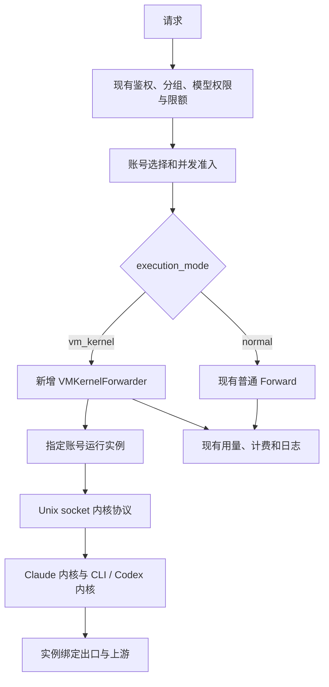

# 账号新增 VM 内核模式实施方案

日期：2026-10-22。基础版本：纯上游 sub2-api v2.15.0，提交 `8b36fe7d647c28e8189147c6bfce52a41b6e26db`。参考机制：vm2api v1.3.206。

状态：待实施方案。当前只整理分支与文档；下文的字段、服务、接口、任务与测试均为计划，不代表已经存在。分支和开发环境记录见 [分支基线说明](vm-kernel-branch-baseline.md)。

## 1. 目标与入口

保留 sub2-api v2.15.0 原有功能，在“账号管理 → 添加账号”增加执行模式：普通模式（默认）、VM 内核模式。

普通模式沿用现有表单、授权、准入、代理、插件、WS、调度及执行流程。选择 VM 模式后，才显示运行模板、节点、出口等字段；提交账号后后台创建专属运行环境、准备凭据、启动内核，完成现有账号准入及 VM 业务验证后进入调度。

账号列表增加模式标记；VM 账号详情增加运行环境、内核状态和任务进度，可查看启停、重建、清理结果。首版不要求用户先到独立虚拟机页面创建实例再绑定账号。

本功能实现的是 VM/容器运行环境到真实内核的调用。通用 Go HTTP Executor、仅更换代理出口或宿主启动内核加空容器，都不能替代这一目标。界面必须标明实际使用 Docker 还是 KVM，Docker 不宣称独立 guest 内核。

## 2. 请求分流与不变边界

分流在账号选定且外层准入完成之后、普通平台 Forward 之前。VMKernelForwarder 返回现有 ForwardResult/OpenAIForwardResult 兼容结果，维持用量记录、计费、请求日志与并发释放。

普通模式保持原调用路径；不全局重写普通账号 HTTPUpstream 或 OAuth 客户端。VM 不支持的协议只对该模式拒绝；不得为实现 VM 功能关闭普通账号已有功能。VM 故障时同一账号不降级为普通执行；是否切换其他账号遵守现有权限和安全重试条件，不能无条件重放已发出的请求。

## 3. 账号模型与兼容合同

新增独立字段 `accounts.execution_mode`，合法值 `normal`、`vm_kernel`，数据库默认 normal。它与 platform、认证 type、已有 account_mode、模型名称分开。

- 老数据、旧创建 API 缺字段：normal，不创建实例。
- 更新缺字段：保持原值；未知非空值拒绝，不静默降级。
- 普通账号初始准入维持上游规则；当前 `Schedulable` 取决于 InitialAdmissionPlan。VM 模式叠加运行环境 readiness，不绕过现有准入。
- VM 账号创建初始不可调度；实例健康、凭据可用、现有准入及业务验证满足条件后启用。
- 实例绑定、内核版本、generation、任务和内部秘密放专用数据模型，不塞进普通 credentials/extra。
- 首版不在普通编辑请求中直接切换模式；后续专门迁移操作需要排空、准备/解绑并验证后切换。
- 导入旧备份默认普通；导入 VM 账号保持 VM 模式并待恢复，不能变成普通账号。复制账号不复制活跃实例绑定或内部 token。
- 调度缓存与账号快照必须携带 mode；开放 VM 创建前完成缓存升级/失效。对旧格式缓存重新取得完整账号，不能因字段缺失把新 VM 账号误当普通账号。
- 先升级所有调度/维护进程，再允许 VM 账号创建。回滚到不认识新字段的版本前持久禁用相关账号，不能只关功能开关。

## 4. 已确认的内核调用合同

以下来源于 vm2api v1.3.206 的公开调用端；尚未实际执行闭源载荷验证。

| 项目 | Claude | Codex |
|---|---|---|
| 内核 | kin-kernel，配套 cli-node/cc-node | kin-codex-kernel |
| 推理路径 | POST /internal/v1/messages | POST /internal/v1/codex/responses |
| 传输 | Unix socket HTTP | Unix socket HTTP |
| socket | run/kernel.sock | run/codex-kernel.sock |
| 健康 | GET /internal/health | GET /internal/health |
| 取消 | POST /internal/v1/cancel，携带 request_id | 调用端使用同一合同，实际能力须验证 |
| 鉴权 | x-kin-internal-token；兼容头 x-internal-token | 同左 |

证据：[rust-kernel-client](https://github.com/dofastted/vm2api/blob/v1.3.206/src/lib/transport/rust-kernel-client.mjs#L8)、[codex-kernel-client](https://github.com/dofastted/vm2api/blob/v1.3.206/src/lib/transport/codex-kernel-client.mjs#L44)、[go-worker-client](https://github.com/dofastted/vm2api/blob/v1.3.206/src/lib/transport/go-worker-client.mjs#L80)。

推理请求需要 envelope，不是直接发送裸 Anthropic/Responses JSON：

- Claude：request_id、body、经过适配的 headers、stream、delivery_mode、preserve_cache_breakpoints、cache_ttl，按能力使用 request_context。
- Codex：request_id、body、headers、stream、session，以及 upstream_transport、user_agent、installation_id 等 options。
- headers 由适配器生成，不允许用户透传内部 token 或任意身份字段。Claude CLI hop 自己构造部分上游请求，不能重复套用普通 HTTP Forward 的改写。

使用现成内核及固定配套载荷，不预设“去掉闭源依赖”。[payload 清单](https://github.com/dofastted/vm2api/blob/v1.3.206/deploy/payload.json) 固定 release 为 payload-2026.10.19-kernel-cli，必须校验 size/SHA256，并核对架构和依赖。其公开源码不能重建所有同版内核；使用和分发按实际 [LICENSE](https://github.com/dofastted/vm2api/blob/v1.3.206/LICENSE) 处理，商业使用需书面授权。

## 5. 从账号创建到内核就绪

VM 账号创建产生持久初始化任务，后台按固定平台模板执行：

1. 检查节点、Linux/CPU 架构、固定镜像、磁盘和出口。
2. 用稳定实例 UUID 建独立 home/run/credentials 目录，生成内部 token，记录唯一账号绑定。
3. 校验内核、CLI、loader/libs 和镜像版本；设置运行 UID 和资源限制。
4. 将账号凭据转换为内核要求格式，原子写入，文件 0600、私有目录 0700。
5. 准备绑定出口、实例内路径配置和运行环境，启动对应内核。
6. 检查内部鉴权、health、可接请求容量、凭据以及真实业务调用。
7. 记录实际容器/VM ID、generation、kernel version 和观测时间；满足账号原准入与 VM 条件后启用。

创建超时先核对实际资源，不重复创建。初始化失败保留任务、资源 ID 和可诊断状态；删除先禁新请求并排空，再精确清理本实例资源。凭据、home、磁盘和恢复记录不是缓存。

首个验证环境建议 Linux amd64。Docker 模板先闭环，KVM 后续独立预检 /dev/kvm、guest 镜像、磁盘和 relay；架构模拟不能未经测试默认视为可用。

## 6. Claude 与 Codex 分别实现

### Claude

上游已有实例内链路：kin-kernel 以 gateway-worker 模式读取 kernel.json，provider=local_cli，再调用匹配的 cli-node/cc-node。wrap、cc、crag 的 CLI/内核组合不能混配。

模板必须明确 socket_path、credential_path、internal_token、claude_bin、并发槽位、请求/响应限制、超时和缓存策略。wrapper 涉及 JOB_IDLE_SECS 与 glibc loader；最小 home/seed/identity 文件集由真实 PoC 验证，不能只复制一个二进制。

凭据需转换为 claudeAiOauth 格式，expiresAt 为毫秒，并处理规范 credentials.json 和官方 .credentials.json 的链接。上游 refresh 经实例内 kin-worker oauth refresh 与 worker.json 完成，不属于 messages 推理端点。

### Codex

配置明确 vm_id、持久 device_id、socket_path、credential_path、proxy_url/proxy_required、internal_token、请求限制和上游 transport；环境代理变量不能引入隐藏出口。凭据文件顶层 accounts 数组首版只放绑定的一个账号。

v1.3.206 的 Codex 内核实际由宿主/控制面 spawn，槽位容器主进程为 sleep infinity。实现用户要求的 VM 内核模式时，必须把内核、依赖、配置、凭据和 socket 放入每账号实例并验证。失败时标记该平台尚不支持，不能回退宿主执行后仍宣称 VM 模式完成。

闭源内核是否写入凭据、如何热加载和刷新仍未确认。凭据协调方案需根据 PoC 确定只读投影或单一实例写入后版本化同步，不能假定内核永不写文件。

## 7. Runtime 模块与结果适配

最小模块按账号/实例提供幂等准备、检查、启停、删除、内核调用、取消和凭据维护。节点内部区分持 Docker 权限的 Manager 与无 Docker 权限的 Kernel Relay；Relay 只访问指定实例的 run/socket/token，不暴露任意 exec 或任意 URL 转发。

同机通过专属 Unix socket，远程通过受认证私网接口到节点 Relay。保持每实例归属和 generation 校验，不能复用其他账号 socket。实例出口故障不降级直连；Claude 原有网络隔离和 Codex proxy_required 的真实效果均需验证。

内核结果适配必须处理：

- SSE 正常终止、工具调用和连续对话。Claude message_stop 后可能还有 job_done/trailers，不能提前断开。
- X-Usage、X-Model、X-Stop-Reason 和限流信息；合并 SSE/trailer 时保留 cache read/write 等细分。
- committed、terminal_state、usage、model、stop_reason；HTTP 200 不等于业务完整成功。
- 区分内核故障、上游鉴权/限流、断流和用户取消；缺 usage 不默认为零成本成功。
- 客户端取消时关闭转发并显式调用 cancel，验证内核槽位释放。
- ready_slots=0 可能只是繁忙，不能反复重启内核。
- 会话绑定账号与实例版本；内核重启后的续聊能力以实测为准，已输出请求不跨内核无条件重放。
- 返回现有 ForwardResult/OpenAIForwardResult，并执行原有上游接受、计费和并发释放所需回调。

## 8. VM 凭据与维护的边界

普通模式保留原刷新、模型、额度和自动授权客户端；仅 VM 模式进入专属 CredentialLifecycle 和维护适配。

单个 VM 账号只能有一个协调刷新流程。授权导入、刷新、文件热更新与回传按版本确认，不能让普通后台 worker 和实例内进程无协调写同一 token。刷新结果不确定时暂停此 VM 账号并恢复，不循环重试旧 refresh token。

首版可使用已有授权导入；是否提供实例内登录另作能力验证。模型、额度、账号测试等操作按真实内核/worker 能力实现；没有对应能力就明确标记尚不支持，不暗中使用普通账号链路。所有限制只作用于 VM 模式。

## 9. 纯上游代码接点

下列路径与行号按 v2.15.0 核对，实施时以函数符号和当时源码为准。

| 模块 | 接点 | 计划改动 |
|---|---|---|
| 模型/输入 | backend/ent/schema/account.go；internal/service/account.go；admin_service.go:426、462 | execution_mode、创建默认与更新缺字段语义 |
| 创建/准入 | internal/handler/admin/account_handler.go:1080；service/admin_account.go:431、463 | normal 原流程；VM 待准备并叠加 InitialAdmissionPlan |
| 持久化 | internal/repository/account_repo.go:172、620、4093 | 创建、更新、映射及手写查询覆盖 |
| DTO | internal/handler/dto/types.go:218、347；mappers.go:242、479 | 列表/详情模式与脱敏实例摘要 |
| 前端 | frontend/src/components/account/CreateAccountModal.vue、EditAccountModal.vue；src/types/index.ts；api/admin/accounts.ts | 普通默认，VM 才展开运行配置 |
| OpenAI 分流 | internal/handler/openai_gateway_handler.go:1115、1750 | 普通 Forward / ForwardAsAnthropic 前增加 VM 专属分支 |
| Claude 分流 | internal/handler/gateway_handler.go:920、924 | 现有平台分流处增加 VM 分支 |
| 特殊能力 | gateway_handler.go:2172 的 count_tokens；WS、插件、harvest 等入口 | VM 按 capability 支持或拒绝，normal 原行为不变 |
| 缓存/调度 | openai_account_scheduler.go；其他账号 snapshot/selector | 保留原资格，加 VM readiness，缓存不能丢 mode |
| 导入导出 | internal/handler/admin/account_data.go | VM 导入待恢复，复制不复用实例 |

本纯上游没有原本地 ticket_borrow 模块或其前置 continuation 改写，不移植这些本地代码，也不将其作为本分支必需改动。上游本身存在的会话、插件和 WS 分支仍需按模式审查。

拟新增核心模块：VMKernelForwarder、VMAccountLifecycle、VMCredentialLifecycle、vmruntime 的 client/protocol/manager/relay/kernel。具体表和 API 在 K1/K2 结果后定稿，不直接照搬上一版通用 HTTP Executor 结构。

## 10. 实施任务与完成条件

| 顺序 | 任务 | 完成条件 |
|---|---|---|
| K1 | 固定载荷的独立内核 PoC | Claude VM→内核→CLI、Codex实例内内核分别验证；token、health、流、取消、出口及凭据写入可确认 |
| K2 | Go 内核客户端和平台适配 | envelope、SSE/trailers、usage、错误、取消、会话合同与固定版本匹配 |
| K3 | 账号执行模式及表单 | 老数据/旧 API 普通默认，更新/缓存/导入不丢 mode，普通准入保持 |
| K4 | 账号驱动生命周期 | 添加 VM 账号自动准备实例，任务幂等可恢复，失败追踪与删除安全 |
| K5 | 接入网关分流 | VM 请求实际到内核；普通 Forward 不改道；计费、限流、并发与日志兼容 |
| K6 | VM 凭据和维护 | 刷新无双写，模型/额度/测试行为明确，结果未知可恢复 |
| K7 | 双链路验收与发布 | 普通上游功能回归通过；VM真实调用、流、工具、取消、重启、故障与回滚通过 |

K1/K2 优先。K3 可在合同确定后并行设计，不能以表单完成或普通 HTTP mock 成功代替真实内核闭环。Claude 与 Codex 分别启用能力；任一平台通过不代表另一平台通过。

## 11. 验收与未验证项

普通链路：老账号、普通添加/编辑/导入、原准入、插件、WS、上游已有其他功能及计费保持；未启用 VM 时不要求 Docker/内核即可运行。

VM 链路：请求可关联 account/instance/kernel version/request ID；内核进程位于声明的运行环境；请求确实进入对应内部端点；响应、usage、工具、多轮、取消和出口均有实际证据。实例 running、内核 ready、真实业务成功分别记录。

故障：重复创建不产生重复资源；VM 未就绪不接请求；断流不错误重放；代理故障不直连；删除失败不丢实际资源 ID；回滚不把 VM 账号当普通账号执行。

未验证：固定 payload 的 ELF/库依赖、最小启动目录、Codex 容器化、内核实际鉴权/取消、凭据热更新/刷新写入、真实账号/出口、内核重启后的会话行为。全部留在 K1 的明确验收中，本阶段不声称已经完成。

后续测试/构建遵循分支基线说明中的临时 Go 缓存与容器清理纪律。纯上游 integration harness 的 os.Exit/defer 问题须在运行容器集成验收前单独处理或严格补偿清理；本轮不修改它。
